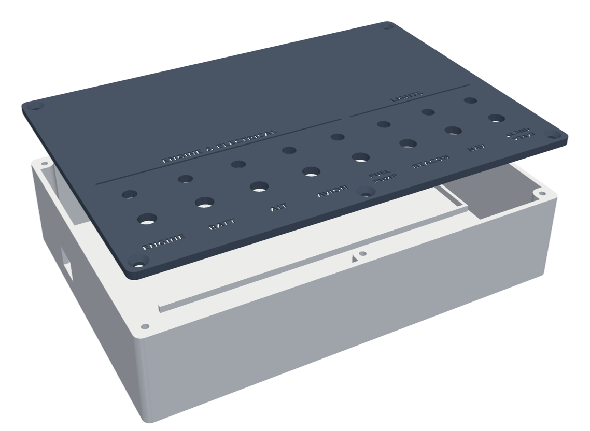

# DIY X-Plane 12 Switch Panel (Raspberry Pi Pico)

An 8-switch panel for X-Plane 12 built with a Raspberry Pi Pico (RP2040) running CircuitPython.
The Pico shows up as a 32-button USB joystick, so X-Plane needs no driver or plugin.

## What's in here

| Path | What it is |
| --- | --- |
| `pico/boot.py` | Presents the Pico as a USB joystick named "DIY Switch Panel" (32 buttons, no axes) |
| `pico/code.py` | Reads the switches, pulses one joystick button per switch position, drives the LEDs |
| `enclosure/base.stl`, `enclosure/lid.stl` | Print-ready enclosure (170.4 × 120.4 × 40 mm, fits a 180 × 180 mm bed, no supports) |
| `enclosure/build.py` | Parametric script that generates the STLs (`pip install manifold3d trimesh numpy matplotlib`) |

## Hardware

- Raspberry Pi Pico or any RP2040 clone with the standard pinout
- 7 × MTS-102 (ON-ON) and 1 × MTS-103 (ON-OFF-ON) mini toggle switches, 6 mm bushing
- 8 × 5 mm LEDs (red / amber / classic green) with 8 × 330 Ω resistors
- 830-point breadboard (160 × 60 × 10 mm), jumper wires, heat-shrink
- 5 × M3 × 21 mm screws for the lid

## Wiring

Every connection is between a GP pin and GND; nothing uses 3V3.

| Switch | Switch pin(s) | LED pin | Joystick buttons (ON / OFF) |
| --- | --- | --- | --- |
| ENGINE | GP0 | GP16 | 1 / 2 |
| BATT | GP1 | GP17 | 3 / 4 |
| ALT | GP2 | GP18 | 5 / 6 |
| AVIONICS | GP3 | GP19 | 7 / 8 |
| FUEL PUMP | GP4 | GP20 | 9 / 10 |
| BEACON | GP5 | GP21 | 11 / 12 |
| NAV | GP6 | GP22 | 13 / 14 |
| LAND / OFF / TAXI | GP7 (up), GP8 (down) | GP26 | up 15 + 18, middle 16 + 18, down 17 + 16 |

- Switch: middle leg → GND, outer leg → GP pin.
- LED: GP pin → 330 Ω → LED long leg; short leg → GND.
- Watch out for the GND pins between the GP pins on the Pico's edges.

## Install

1. Hold BOOTSEL, plug the Pico in, and copy the CircuitPython `.uf2` for "Raspberry Pi Pico" onto the `RPI-RP2` drive.
2. Copy `pico/boot.py` and `pico/code.py` onto the `CIRCUITPY` drive.
3. Unplug and replug the Pico (`boot.py` only runs at power-up).
4. In X-Plane 12, open *Settings → Joystick*, pick "DIY Switch Panel" and assign commands to buttons 1–18.

Some USB-C Pico clones get no power over a USB-C to USB-C cable (missing CC resistors). Connect them through a USB-A port or adapter.

## Suggested X-Plane commands

| Buttons | Commands |
| --- | --- |
| 1 / 2 | `sim/operation/auto_start` / `sim/magnetos/magnetos_off` |
| 3 / 4 | `sim/electrical/battery_1_on` / `sim/electrical/battery_1_off` |
| 5 / 6 | `sim/electrical/generator_1_on` / `sim/electrical/generator_1_off` |
| 7 / 8 | `sim/systems/avionics_on` / `sim/systems/avionics_off` |
| 9 / 10 | `sim/fuel/fuel_pump_1_on` / `sim/fuel/fuel_pump_1_off` |
| 11 / 12 | `sim/lights/beacon_lights_on` / `sim/lights/beacon_lights_off` |
| 13 / 14 | `sim/lights/nav_lights_on` / `sim/lights/nav_lights_off` |
| 15 / 16 | `sim/lights/landing_lights_on` / `sim/lights/landing_lights_off` |
| 17 / 18 | `sim/lights/taxi_lights_on` / `sim/lights/taxi_lights_off` |
